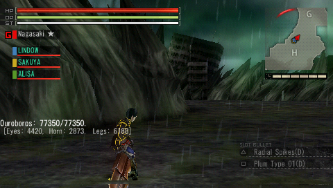
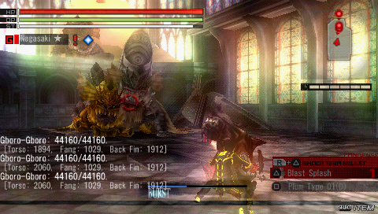
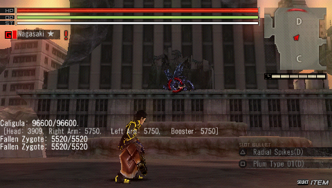
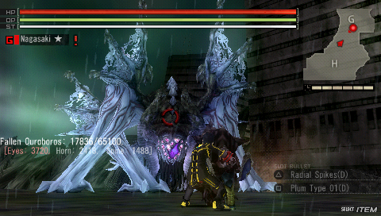
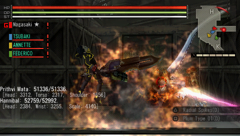
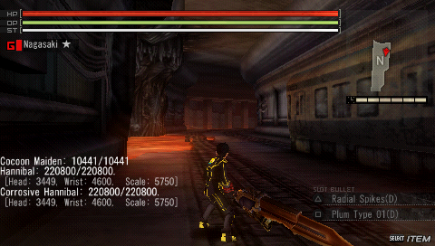
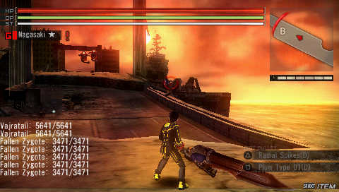
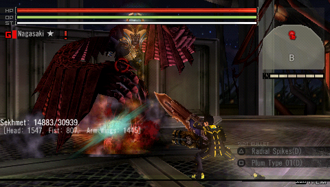
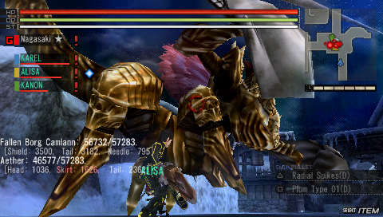
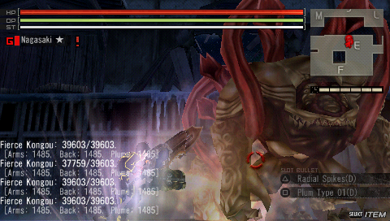

# GOD_HOOK
GOD EATER BURST Hook Libraries for PSP/PPSSPP

#### TO-DO
- Add 1.01/1.61 JAPANESE Support (NPJH-50352)
- Add new hooking libraries

### Special Thanks
- xan1242 for PSPModBase: https://github.com/xan1242/PSPModBase
- ThirteenAG for PSPSDK: https://github.com/ThirteenAG/pspsdk

## Build
- i use windows. set your SDK PATH or location of the PSPSDK in the PSPModBase in the *.cmd file
- Use PowerShell to compile: `build-gcc11.cmd --clean-first`

## HP Hook Library Preview

  
  

  
  

  
  

  
  

  
  

